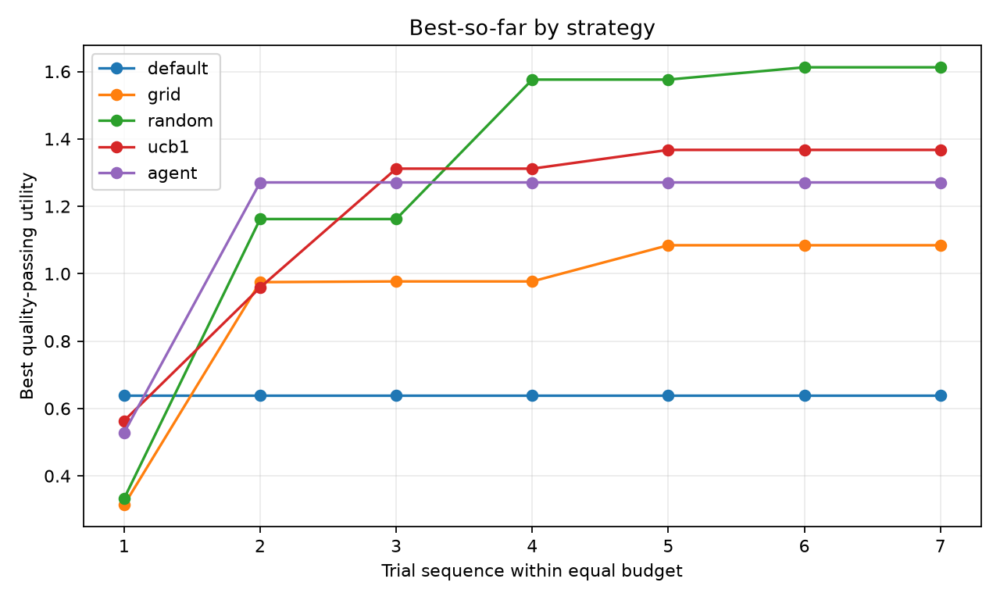
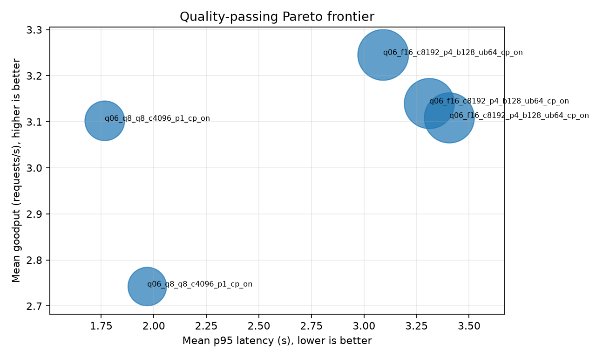
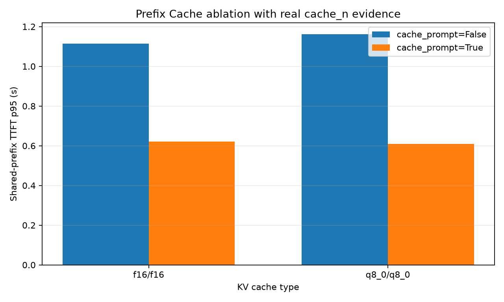

# Experiment optimization report

This report is derived from the append-only SQLite ledger at
`artifacts/experiments/p0_p1_rsi_prefix_v3_20261123/ledger.sqlite`. Every value below comes from a
quality-gated local trial.

## Scope

The measured backend is `llama.cpp` on this Mac. The report does not claim
vLLM, SGLang, CUDA, NPU, distributed serving, or production SLA results.

Hardware: `{"logical_cores": 10, "machine": "arm64", "memory_gb": 16.0, "physical_cores": 10, "processor": "arm"}`

Runtime: `{"llama_server": "version: 1.0.0 (build 12359, commit b1b770d90)\nbuilt with AppleClang 21.0.0.21000401 for Darwin arm64", "platform": "macOS-26.6.2-arm64-arm-64bit", "python": "3.12.15 (main, Sep 30 2026, 22:04:19) [Clang 21.0.0 (clang-2100.3.34.2)]"}`

## Equal-budget strategy comparison

| strategy | trials | quality_passed_trials | best_utility | best_candidate | best_trial_id |
| --- | --- | --- | --- | --- | --- |
| default | 7 | 7 | 0.638003 | q06_f16_c4096_p1_cp_off | trial-855133442e33f7ac39c1 |
| grid | 7 | 7 | 1.08436 | q06_f16_c8192_p4_b128_ub64_cp_on | trial-d66a6ddfff2a13cc412d |
| random | 7 | 7 | 1.61242 | q06_q8_q8_c4096_p1_cp_on | trial-f079c2ff18852b7fc1fc |
| ucb1 | 7 | 7 | 1.36733 | q06_q8_q8_c4096_p1_cp_on | trial-13fc5f60f146c94831a7 |
| agent | 7 | 7 | 1.27079 | q06_f16_c8192_p4_b128_ub64_cp_on | trial-0783b9d18ae025b69004 |

All strategies receive the same scored trial budget. The common baseline anchor
is outside the strategy budget and is used only for deterministic deltas.

The fixed-QPS `rag_reading` workload targeted 2.0 requests/s. Actual scheduled
arrival rates ranged from 1.981-2.007 requests/s, so the open-loop scheduler is reported as
measured rather than assumed.

The agent policy improved its own best-so-far utility by 140.58% over its first trial. This does not imply that the agent beat every strategy: the measured equal-budget winner remains visible in the table.

## Best-so-far



## Quality-passing Pareto frontier

| trial_id | strategy | candidate_id | goodput | p95_latency_s | peak_rss_mb |
| --- | --- | --- | --- | --- | --- |
| trial-d65b6048e96aa8348cba | random | q06_f16_c8192_p4_b128_ub64_cp_on | 3.24512 | 3.0912 | 1907.98 |
| trial-0783b9d18ae025b69004 | agent | q06_f16_c8192_p4_b128_ub64_cp_on | 3.13955 | 3.31072 | 1860.27 |
| trial-21b9f738a78ad194ea28 | agent | q06_f16_c8192_p4_b128_ub64_cp_on | 3.10834 | 3.40595 | 1855.32 |
| trial-24da0c645cc87eab57a2 | random | q06_q8_q8_c4096_p1_cp_on | 3.10205 | 1.76685 | 1162.94 |
| trial-13fc5f60f146c94831a7 | ucb1 | q06_q8_q8_c4096_p1_cp_on | 2.7422 | 1.96899 | 1096.98 |



## Prefix Cache ablation

The shared-prefix workload repeats one long document and changes only the final
question. `cache_n` and prompt-token counts are raw llama.cpp timing fields; a
missing or null field is marked invalid and excluded from the numerator. The hit
rate is `sum(valid cache_n) / sum(valid prompt_tokens)`.

| kv_cache | cache_hit_rate_enabled | cache_hit_rate_disabled | cache_evidence_valid_enabled | cache_evidence_valid_disabled | invalid_cache_observations_enabled | invalid_cache_observations_disabled | ttft_p95_enabled_s | ttft_p95_disabled_s | ttft_p95_reduction_pct | goodput_change_pct | peak_rss_change_pct | error_rate_enabled | error_rate_disabled |
| --- | --- | --- | --- | --- | --- | --- | --- | --- | --- | --- | --- | --- | --- |
| f16/f16 | 0.825514 | 0 | True | True | 0 | 0 | 0.621412 | 1.11373 | 44.2043 | 262.781 | 4.75027 | 0 | 0 |
| q8_0/q8_0 | 0.825514 | 0 | True | True | 0 | 0 | 0.610085 | 1.16096 | 47.4501 | 271.699 | 2.35626 | 0 | 0 |



TTFT reductions are request-level observations. They are reported separately
from `cache_n`, so a timing improvement is not presented as proof of cache reuse
unless the measured cache evidence is valid.

## Run integrity

- Trial records: 36
- Quality-passing complete trials: 36
- Failed or quality-rejected trials: 0
- Structured reflections: 36
- Positive experiences: 36
- Negative memories: 0
- Bottleneck categories: `{"no_material_bottleneck": 19, "rss_memory_pressure": 10, "ttft_bottleneck": 7}`
- Similar-history evidence: `similar_history.json`
- Full per-trial metrics and intervals: `trial_metrics.csv`
- Reflection memory export: `reflections.json`
- Ledger export: `artifacts/experiments/<experiment_id>/export/trials.jsonl`

## Limitations

- Fixed quality probes verify exact answer, a critical fact, JSON structure, and
  timeout behavior. They do not replace the separate 100-question RAG/Agent
  benchmark.
- Peak RSS covers the model service process tree. It is not total system memory
  or GPU memory.
- Goodput uses the workload SLO and successful local responses.
- The RAG-shaped workload holds retrieved context fixed to isolate serving cost.

## Reproduction

```bash
./llm-bench --config configs/default.yaml experiment run \
  --spec configs/experiments_p0_p1.yaml
./llm-bench --config configs/default.yaml experiment report \
  --ledger artifacts/experiments/p0_p1_rsi_prefix_v3_20261123/ledger.sqlite
```
