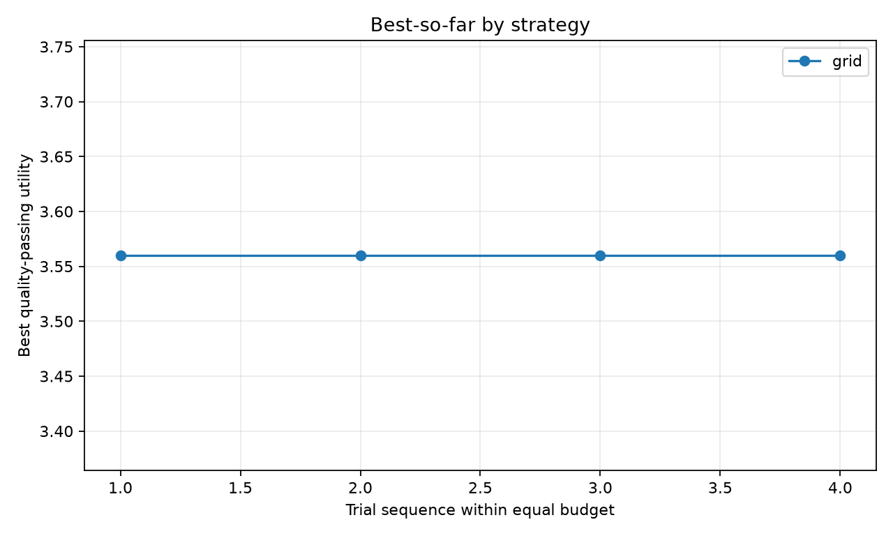
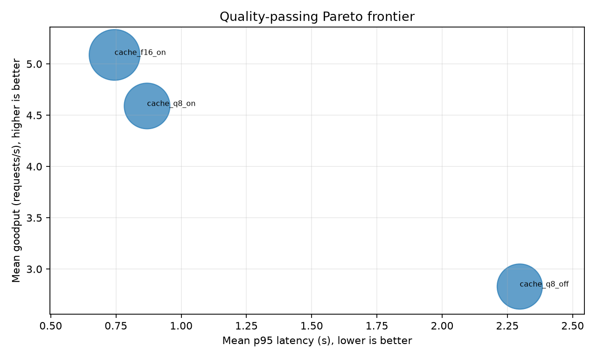
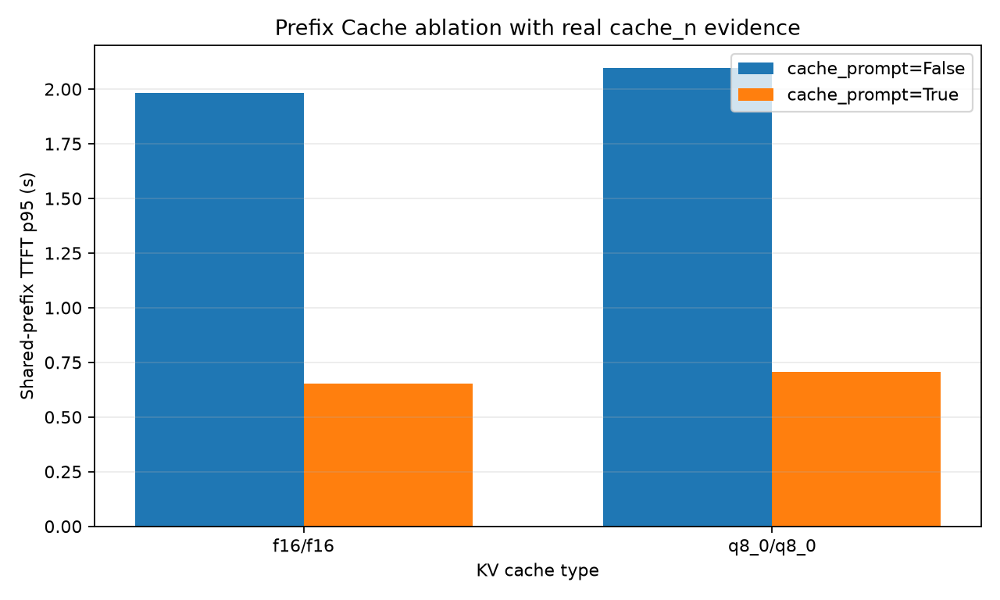

# Experiment optimization report

This report is derived from the append-only SQLite ledger at
`artifacts/experiments/prefix_cache_ablation_20261123/ledger.sqlite`. Every value below comes from a
quality-gated local trial.

## Scope

The measured backend is `llama.cpp` on this Mac. The report does not claim
vLLM, SGLang, CUDA, NPU, distributed serving, or production SLA results.

Hardware: `{"logical_cores": 10, "machine": "arm64", "memory_gb": 16.0, "physical_cores": 10, "processor": "arm"}`

Runtime: `{"llama_server": "version: 1.0.0 (build 12359, commit b1b770d90)\nbuilt with AppleClang 21.0.0.21000401 for Darwin arm64", "platform": "macOS-26.6.2-arm64-arm-64bit", "python": "3.12.15 (main, Sep 30 2026, 22:04:19) [Clang 21.0.0 (clang-2100.3.34.2)]"}`

## Equal-budget strategy comparison

| strategy | trials | quality_passed_trials | best_utility | best_candidate | best_trial_id |
| --- | --- | --- | --- | --- | --- |
| default | 0 | 0 |  |  |  |
| grid | 4 | 4 | 3.55975 | cache_f16_on | trial-030f59884a1da99c4d20 |
| random | 0 | 0 |  |  |  |
| ucb1 | 0 | 0 |  |  |  |
| agent | 0 | 0 |  |  |  |

All strategies receive the same scored trial budget. The common baseline anchor
is outside the strategy budget and is used only for deterministic deltas.

The fixed-QPS `rag_reading` workload targeted 2.0 requests/s. Actual scheduled
arrival rates ranged from 1.989-2.017 requests/s, so the open-loop scheduler is reported as
measured rather than assumed.

No Agent strategy was run in this experiment.

## Best-so-far



## Quality-passing Pareto frontier

| trial_id | strategy | candidate_id | goodput | p95_latency_s | peak_rss_mb |
| --- | --- | --- | --- | --- | --- |
| trial-ec14ce3774ad0f6929b0 | baseline_anchor | cache_f16_on | 5.08799 | 0.744473 | 1267.05 |
| trial-437eda8dc67b3b725fbb | grid | cache_q8_on | 4.58986 | 0.869114 | 1026.66 |
| trial-c438908f7a28670c68be | grid | cache_q8_off | 2.82877 | 2.29736 | 1004.87 |



## Prefix Cache ablation

The shared-prefix workload repeats one long document and changes only the final
question. `cache_n` and prompt-token counts are raw llama.cpp timing fields; a
missing or null field is marked invalid and excluded from the numerator. The hit
rate is `sum(valid cache_n) / sum(valid prompt_tokens)`.

| kv_cache | cache_hit_rate_enabled | cache_hit_rate_disabled | cache_evidence_valid_enabled | cache_evidence_valid_disabled | invalid_cache_observations_enabled | invalid_cache_observations_disabled | ttft_p95_enabled_s | ttft_p95_disabled_s | ttft_p95_reduction_pct | goodput_change_pct | peak_rss_change_pct | error_rate_enabled | error_rate_disabled |
| --- | --- | --- | --- | --- | --- | --- | --- | --- | --- | --- | --- | --- | --- |
| f16/f16 | 0.936286 | 0 | True | True | 0 | 0 | 0.651757 | 1.98405 | 67.1502 | 422.022 | 4.13707 | 0 | 0 |
| q8_0/q8_0 | 0.936286 | 0 | True | True | 0 | 0 | 0.704993 | 2.09512 | 66.3506 | 478.311 | 5.13125 | 0 | 0 |



TTFT reductions are request-level observations. They are reported separately
from `cache_n`, so a timing improvement is not presented as proof of cache reuse
unless the measured cache evidence is valid.

## Run integrity

- Trial records: 5
- Quality-passing complete trials: 5
- Failed or quality-rejected trials: 0
- Structured reflections: 5
- Positive experiences: 0
- Negative memories: 0
- Bottleneck categories: `{"no_material_bottleneck": 5}`
- Similar-history evidence: `similar_history.json`
- Full per-trial metrics and intervals: `trial_metrics.csv`
- Reflection memory export: `reflections.json`
- Ledger export: `artifacts/experiments/<experiment_id>/export/trials.jsonl`

## Limitations

- Fixed quality probes verify exact answer, a critical fact, JSON structure, and
  timeout behavior. They do not replace the separate 100-question RAG/Agent
  benchmark.
- Peak RSS covers the model service process tree. It is not total system memory
  or GPU memory.
- Goodput uses the workload SLO and successful local responses.
- The RAG-shaped workload holds retrieved context fixed to isolate serving cost.

## Reproduction

```bash
./llm-bench --config configs/default.yaml experiment run \
  --spec configs/experiments_p0_p1.yaml
./llm-bench --config configs/default.yaml experiment report \
  --ledger artifacts/experiments/prefix_cache_ablation_20261123/ledger.sqlite
```
