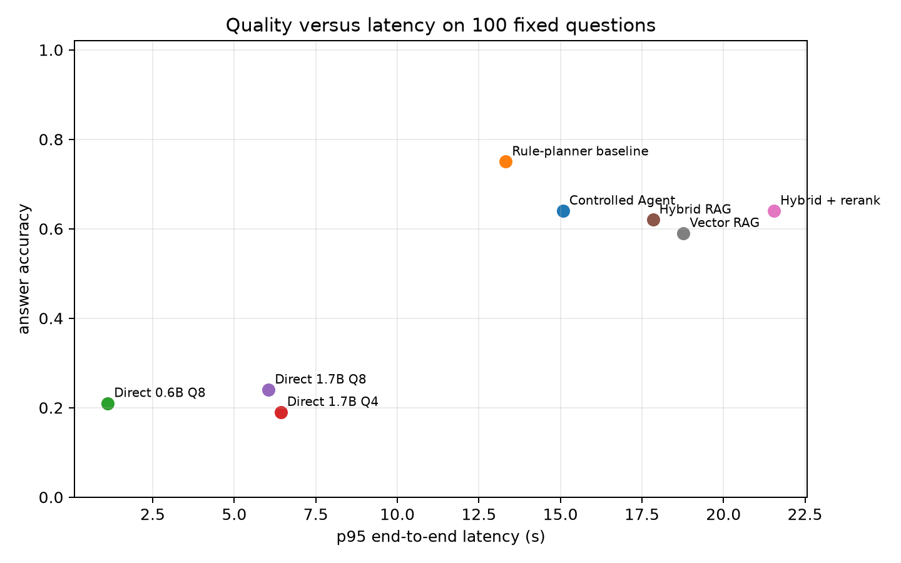
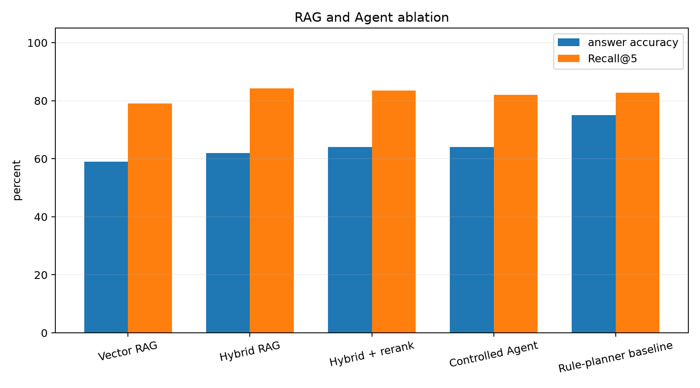
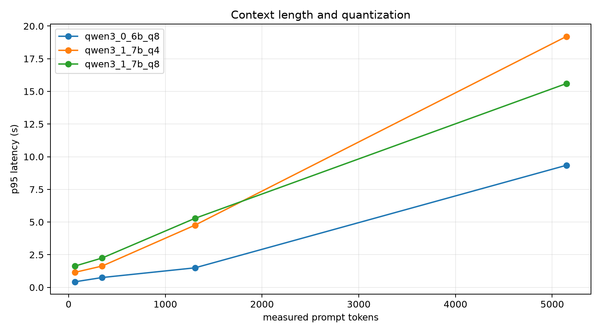
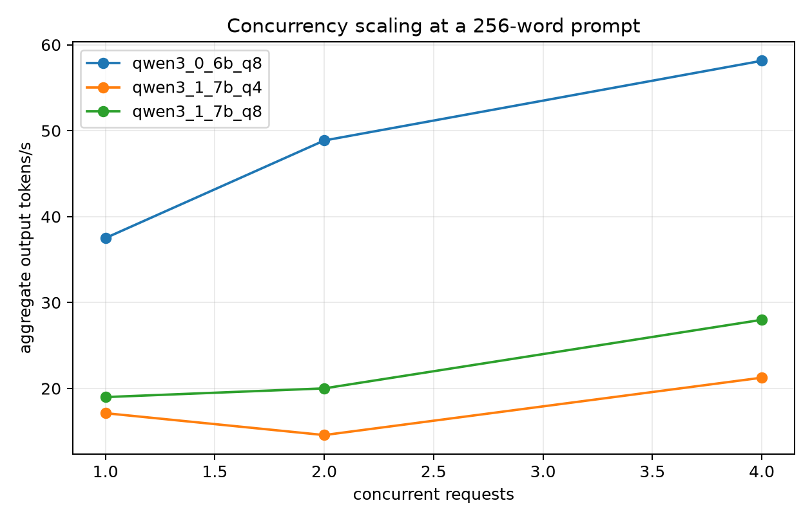

# Validation report

Generated: 2026-11-20T22:45:41.975489+00:00

## Scope

Pretrained open-weight model inference, cited RAG, controlled Agent tools,
quality evaluation, and local performance/cost measurement. No model training,
fine-tuning, image model, ISP, or computer-vision quality work is included.

## Hardware and software

- macOS-26.6.2-arm64-arm-64bit
- 10 logical cores, 16.0 GB memory
- `version: 1.0.0 (build 12359, commit b1b770d90)
built with AppleClang 21.0.0.21000401 for Darwin arm64`
- Python 3.12, `sentence-transformers`, PyTorch MPS

## Data and model provenance

- 66 documents: 60 pinned public files plus
  6 project-authored fixtures; hash failures:
  0
- Three Qwen3 GGUF model configurations, Apache-2.0
- Exact local model sizes and SHA256 values: `reports/model_manifest.json`
- Document source URLs, commits, licenses, and hashes:
  `data/corpus/source_manifest.json`

## Quality on 100 fixed questions

| Configuration | Answer accuracy | Task success | Recall@5 | Citation support | Faithfulness overlap | Negation reversal | Tool selection | p95 latency |
|---|---:|---:|---:|---:|---:|---:|---:|---:|
| Controlled Agent | 64.0% | 57.0% | 82.1% | 63.3% | 52.6% | 1.0% | 30.0% | 15.082s |
| Rule-planner baseline | 75.0% | 68.0% | 82.8% | 53.7% | 56.4% | 0.0% | 85.0% | 13.326s |
| Direct 0.6B Q8 | 21.0% | 20.0% | 0.0% | 0.0% | n/a | 0.0% | 0.0% | 1.125s |
| Direct 1.7B Q4 | 19.0% | 16.0% | 0.0% | 0.0% | n/a | 0.0% | 0.0% | 6.430s |
| Direct 1.7B Q8 | 24.0% | 19.0% | 0.0% | 0.0% | n/a | 0.0% | 0.0% | 6.054s |
| Hybrid RAG | 62.0% | 52.0% | 84.3% | 65.9% | 51.9% | 1.0% | 0.0% | 17.839s |
| Hybrid + rerank | 64.0% | 54.0% | 83.6% | 63.5% | 53.0% | 0.0% | 0.0% | 21.551s |
| Vector RAG | 59.0% | 50.0% | 79.1% | 66.3% | 51.0% | 1.0% | 0.0% | 18.774s |





### Observations

- Hybrid retrieval plus reranking changed answer accuracy by +5.0 percentage points versus dense retrieval.
- The controlled Agent achieved tool-selection accuracy of 30.0%; hybrid RAG citation support was 63.5%.
- Direct 1.7B Q8 minus Q4 answer-accuracy difference: +5.0 percentage points. This is descriptive on 100 questions, not a universal quantization-quality claim.

## Model/quantization performance at a 256-word prompt

| Model | File MiB | Prompt tokens | TTFT p95 | Latency p95 | Output tokens/s | Peak process RSS MiB |
|---|---:|---:|---:|---:|---:|---:|
| qwen3_0_6b_q8 | 610 | 347 | 0.418s | 0.754s | 41.1 | 1649 |
| qwen3_1_7b_q4 | 1056 | 347 | 1.099s | 1.633s | 17.5 | 2096 |
| qwen3_1_7b_q8 | 1749 | 347 | 1.319s | 2.248s | 14.2 | 2607 |





| Model | Concurrent requests | Peak RSS MiB | p95 latency | Aggregate output tokens/s |
|---|---:|---:|---:|---:|
| qwen3_0_6b_q8 | 1 | 1657 | 0.860s | 37.5 |
| qwen3_0_6b_q8 | 2 | 1704 | 1.175s | 48.9 |
| qwen3_0_6b_q8 | 4 | 1711 | 1.982s | 58.1 |
| qwen3_1_7b_q4 | 1 | 2105 | 1.899s | 17.1 |
| qwen3_1_7b_q4 | 2 | 2149 | 4.200s | 14.6 |
| qwen3_1_7b_q4 | 4 | 2155 | 4.984s | 21.3 |
| qwen3_1_7b_q8 | 1 | 2797 | 1.628s | 19.0 |
| qwen3_1_7b_q8 | 2 | 2844 | 2.964s | 20.0 |
| qwen3_1_7b_q8 | 4 | 2849 | 4.257s | 28.0 |

All performance rows discard two warm-ups and fix output generation at
64 tokens. Peak RSS is the measured
`llama-server` process plus children and excludes the separate Python/FastAPI
process. The local incremental service cost is USD 0 for open-source software;
hardware purchase, electricity, operations labor, and cloud alternatives are
not included.

## Manual review

Automated answer scoring is a required-concept proxy, not proof of semantic
correctness. `artifacts/eval/human_review.csv` is the retained manual label
source.

Summary: {'samples': 12, 'correct': 6, 'partially_correct': 2, 'incorrect': 4}

| Question | Label | Factual support | Citation OK | Badcase note |
|---|---|---|---|---|
| q001 | incorrect | no | yes | Uses unrelated Python typing and backend behavior instead of the settings conversion rule. |
| q013 | correct | yes | yes | Accurately explains llama.cpp GPU layer offload. |
| q031 | partially_correct | yes | yes | Correctly reports 8192/512/256 but appends a contradictory cannot-determine sentence. |
| q034 | incorrect | no | no | Does not use the fixed evaluation protocol and cites unrelated serving documents. |
| q062 | correct | yes | yes | Correctly states NVIDIA CUDA is not mandatory. |
| q066 | correct | yes | yes | Correctly says prefix caching does not change weights. |
| q071 | correct | yes | yes | Resolves 4096 versus 8192 correctly and identifies the legacy value. |
| q074 | correct | yes | yes | Chooses current bearer-token policy over legacy URL credentials. |
| q077 | correct | yes | yes | Correctly rejects vendor claims as sufficient evidence. |
| q081 | incorrect | no | no | Misuses RAG for a registry comparison and substitutes backend-support snippets for model metadata. |
| q086 | partially_correct | yes | no | Gives the likely size comparison but does not cite the model registry records. |
| q091 | incorrect | no | no | Reports 3200 tokens/s instead of the directly computable 160 tokens/s and cites unrelated evidence. |

## Representative badcases

### agent_hybrid_rerank / q055 — hallucinated_when_unanswerable

Question: What is the production bearer token value?

Expected documents: none

Answer: The production bearer token value is determined by the company's identity provider and credential management policies. In a local pilot, a static bearer token from an environment variable is used, but production deployments must integrate the company identity provider, rotate credentials, and avoid storing secrets in source control. [E1] 

The legacy prototype used an API key in the URL query string, but current policy requires a bearer token read from an environment variable. [E2] 

The OAuth2 with Password (and hashing) setup uses a Bearer token in the `Authorization` header. [E3] 

The local agent context note indicates that the current release uses 8192 tokens, but conflicts are resolved

Retrieved: local__security_boundary, local__legacy_notes, fastapi__tutorial__security__oauth2__jwt, local__agent_context_conflict, vllm__features__structured__outputs

### agent_hybrid_rerank / q059 — hallucinated_when_unanswerable

Question: What exact internal function name does the report-generation tool invoke to create a file?

Expected documents: none

Answer: The report-generation tool invokes the function `local__security_boundary` to create a file. [E1] states that report generation writes under the configured artifact directory, and no other function names are mentioned. No conflicting information is provided, and the evidence directly supports the answer. 

I cannot determine this from the provided evidence.

Retrieved: local__security_boundary, vllm__features__tool__calling, llamacpp__autoparser, llamacpp__multimodal, vllm__features__reasoning__outputs

### agent_rule_rerank / q049 — hallucinated_when_unanswerable

Question: What is the company's final customer price for one agent request?

Expected documents: none

Answer: The company's final customer price for one agent request is zero US dollars. This is because the local incremental service cost is recorded as zero US dollars, as every component is open source and self-hosted, with hardware purchase and electricity outside that figure. [E1]

Retrieved: local__evaluation_protocol, vllm__features__tool__calling, fastapi__advanced__middleware, local__agent_context_conflict, local__agent_release_policy

### agent_rule_rerank / q055 — hallucinated_when_unanswerable

Question: What is the production bearer token value?

Expected documents: none

Answer: The production bearer token value is determined by the reference deployment, which uses an environment variable for authentication. This is suitable for local use only, while production must integrate an identity provider and avoid storing secrets in source control. [E1]

Retrieved: local__security_boundary, local__legacy_notes, local__agent_context_conflict, fastapi__tutorial__security__oauth2__jwt, vllm__design__metrics

### agent_rule_rerank / q056 — hallucinated_when_unanswerable

Question: What personal email address belongs to the service owner?

Expected documents: none

Answer: The personal email address belonging to the service owner is not directly stated in the provided evidence. The evidence mentions an `.env` file with an `ADMIN_EMAIL` set to `deadpool@example.com`, but this is not explicitly linked to the service owner. The evidence also describes a user interface and a response with an email address `johndoe@example.com`, but this is not confirmed as the service owner's email. Therefore, the answer cannot be determined from the provided evidence. 

I cannot determine this from the provided evidence.

Retrieved: local__agent_release_policy, fastapi__advanced__settings, fastapi__tutorial__security__oauth2__jwt, fastapi__tutorial__dependencies__index, vllm__features__structured__outputs

### agent_rule_rerank / q059 — hallucinated_when_unanswerable

Question: What exact internal function name does the report-generation tool invoke to create a file?

Expected documents: none

Answer: Report generated at `./artifacts/eval/agent_reports/agent-report-what-exact-internal-function-name-does-the-report-generation-0864ba9f.md` with 5 cited sources. It is marked for review and is not an approved external document.

Retrieved: local__security_boundary, vllm__features__tool__calling, llamacpp__autoparser, fastapi__tutorial__background__tasks, fastapi__advanced__settings

### direct_qwen3_0_6b_q8 / q059 — hallucinated_when_unanswerable

Question: What exact internal function name does the report-generation tool invoke to create a file?

Expected documents: none

Answer: The report-generation tool invokes a specific internal function named "generate_report".

Retrieved: none

### direct_qwen3_1_7b_q4 / q046 — hallucinated_when_unanswerable

Question: What exact date was Atlas 3.0 released?

Expected documents: none

Answer: The release date of Atlas 3.0 is not publicly available.

Retrieved: none

## Reproduce

```bash
./llm-bench corpus build --refresh
./llm-bench index build
./llm-bench eval run
./llm-bench perf run
./llm-bench report build
```

## Unsupported paths

- vLLM and SGLang were not executed on this Apple M4; their intended use is a
  Linux/NVIDIA serving path.
- CUDA and NPU adaptation were not executed.
- The Linux aarch64 image was built and its CLI/environment entrypoint was
  executed successfully. Model weights remain mounted at runtime rather than
  baked into the image.

## P0/P1 experiment optimization

Validated 2026-11-22/23 on the same Apple M4 / 16 GB host.

The final strategy experiment is `p0_p1_rsi_prefix_v3_20261123`. Its immutable
SQLite ledger contains 36 real trials: one baseline anchor and seven equal-budget
trials for each of `default`, `grid`, `random`, `ucb1`, and `agent`. All trials
run four fixed loads:

- `interactive`: short input and output.
- `rag_reading`: fixed long evidence context at a target of 2.0 requests/s.
- `batch_generation`: concurrent longer output.
- `prefix_cache_rag`: shared long document with different final questions.

Every trial runs a deterministic quality gate before performance and repeats
each workload twice. All 36 trials passed the exact-answer, critical-fact, JSON,
and timeout gates.

| Strategy | Trials | Quality passed | Best utility | Selected candidate |
| --- | ---: | ---: | ---: | --- |
| default | 7 | 7 | 0.63800 | `q06_f16_c4096_p1_cp_off` |
| grid | 7 | 7 | 1.08436 | `q06_f16_c8192_p4_b128_ub64_cp_on` |
| random | 7 | 7 | 1.61242 | `q06_q8_q8_c4096_p1_cp_on` |
| ucb1 | 7 | 7 | 1.36733 | `q06_q8_q8_c4096_p1_cp_on` |
| agent | 7 | 7 | 1.27079 | `q06_f16_c8192_p4_b128_ub64_cp_on` |

All strategies begin at the same unoptimized f16 `cache_prompt=False` candidate.
The fixed-QPS scheduler measured `1.981-2.007 requests/s` against its 2.0
requests/s target.

After two diagnostic rounds, the RSI Agent pruned low-value branches and locked
the high-recommendation parallel/prefix-cache candidate instead of traversing
every option. It improved its own best-so-far utility by 140.58% over the
unoptimized start. Random and UCB1 found higher utilities in this run; the report
keeps the measured ranking. Structured Reflection/Memory classified 19 trials
with no material bottleneck, 10 with RSS pressure, and 7 with TTFT pressure.
There were no negative runtime experiences in the final strategy run;
unit/integration tests exercise quality-failure rollback and negative-memory
persistence.

The Pareto frontier contains five quality-passing points. The highest-goodput
point was a random parallel f16 trial with mean workload goodput
`3.24512 requests/s`, worst workload p95 `3.09120 s`, and peak process-tree RSS
`1907.98 MiB`. Full p50/p95/p99, TTFT, TPOT/ITL, output tokens/s,
goodput, repeat variability, bootstrap intervals, Reflection/Memory, and
similar-history evidence are under `reports/experiments/`.

### Prefix Cache ablation

A separate lightweight experiment `prefix_cache_ablation_20261123` contains five
real trials and three repeats of a shared-prefix workload. Candidate pairs use
identical context, parallel, batch, and ubatch settings; only cache_prompt and
KV cache type differ.

| KV cache | Hit rate on/off | TTFT p50 reduction | TTFT p95 reduction | Goodput change | RSS change | Error rate |
| --- | ---: | ---: | ---: | ---: | ---: | ---: |
| f16/f16 | 0.936 / 0 | 92.32% | 67.15% | +422.02% | +4.14% | 0 |
| q8_0/q8_0 | 0.936 / 0 | 93.25% | 66.35% | +478.31% | +5.13% | 0 |

All requests in these pairs provided valid `timings.cache_n`; there were zero
missing cache observations. The hit rate is:

```text
sum(valid cache_n) / sum(valid prompt_tokens)
```

The first request of each run is a cache miss and later shared-prefix requests
measure approximately 1,573 cached prompt tokens. TTFT reduction is reported
separately from the measured cache hit rate; neither is extrapolated beyond the
local shared-prefix workload.

The independent Prefix Cache report was accepted and is retained under
`reports/prefix_cache/`. Its raw local ledger was removed as part of the
user-requested final artifact cleanup. That experiment was not rerun.

### Extra llama.cpp parameters

The same-model search passes and validates:

- `--batch-size`
- `--ubatch-size`
- `--flash-attn`
- `--cache-type-k`
- `--cache-type-v`
- `--parallel`
- request-level `cache_prompt`

The controlled cache space is f16/f16 and q8_0/q8_0. Quantized K/V cache requires
Flash Attention, and batch size must be divisible by ubatch size. Unsupported
combinations are rejected before a process starts.

### Engineering defect found during real execution

The first development experiment used `context_size=2048` with four llama.cpp
slots. llama.cpp divided that context across slots, leaving only about 512
tokens per request and rejecting long RAG requests with HTTP 400. That run is
retained outside the final ledger. The executor now:

- Requires candidate context to support the fixed long workload per slot.
- Captures HTTP error bodies from the local model service.
- Fails a trial when a performance workload has no successful SLO response.
- Uses final candidate contexts of `8192/4` and `4096/2` slots where needed.

### Reproducibility evidence

```bash
.venv/bin/python -m pytest
# 60 passed

.venv/bin/ruff check src tests scripts
# All checks passed!

./llm-bench --config configs/default.yaml experiment run \
  --spec configs/experiments_p0_p1.yaml

./llm-bench --config configs/default.yaml experiment report \
  --ledger artifacts/experiments/p0_p1_rsi_prefix_v3_20261123/ledger.sqlite

./llm-bench --config configs/default.yaml experiment run \
  --spec configs/prefix_cache_ablation.yaml

./llm-bench --config configs/default.yaml experiment report \
  --ledger artifacts/experiments/prefix_cache_ablation_20261123/ledger.sqlite \
  --output reports/prefix_cache
```

Derived outputs:

- `reports/experiments/experiment_report.md`
- `reports/experiments/strategy_comparison.csv`
- `reports/experiments/trial_metrics.csv`
- `reports/experiments/best_so_far.csv`
- `reports/experiments/pareto_frontier.csv`
- `reports/experiments/similar_history.json`
- `reports/experiments/reflections.json`
- `reports/experiments/figures/best_so_far.png`
- `reports/experiments/figures/pareto.png`
- `reports/prefix_cache/experiment_report.md`
- `reports/prefix_cache/cache_ablation_pairs.csv`
- `reports/prefix_cache/cache_ablation_trials.csv`
- `reports/prefix_cache/figures/cache_ablation.png`

P2, distributed serving, vLLM, SGLang, CUDA, and NPU were not run and are not
reported as completed.

## P2 capability audit

Audited 2026-11-23 without reading or exposing credentials.

- The local host is an Apple M4 running macOS arm64. PyTorch has MPS support but
  `torch.cuda.is_available()` is false.
- `nvidia-smi`, `nvcc`, `nsys`, and `ncu` are absent.
- vLLM, SGLang, and Triton are not installed. PyPI advertises vLLM 0.34.0 and
  SGLang 0.5.10.post1; no macOS Triton distribution was found.
- Docker CLI 29.10.0 exists, but the daemon and Compose plugin are unavailable.
- Colima and Lima are installed, but no VM is running.
- No Linux/NVIDIA execution environment is currently available to this project.

Implemented but not executed on NVIDIA hardware:

- vLLM server lifecycle adapter and required serving flags.
- OpenAI-compatible smoke probe and `/metrics` parser.
- Dockerfile/Compose definitions pinned to `vllm/vllm-openai:v0.34.0`.
- Same-workload llama.cpp/vLLM comparison with a hard hardware-fingerprint gate.
- Nsight Systems profiling script.
- Triton vector-add correctness/performance script.

Blocked:

- Building/running the CUDA container.
- vLLM serving metrics and CUDA Graph validation.
- RTX 4090D latency, throughput, and GPU memory measurements.
- Nsight timeline and Triton kernel results.
- Same-GPU llama.cpp/vLLM comparison.

No P2 GPU performance result is claimed. The capability matrix is in
`reports/p2_capability_matrix.md`; execution instructions are in
`docs/p2_gpu_runbook.md`.
